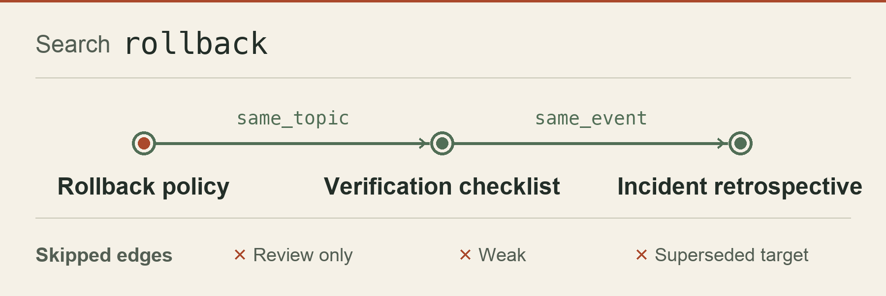

# LMC-5

[简体中文](README.zh-CN.md) · [Two-hop recall](#follow-a-rollback-query-two-hops) · [Quickstart](#retrieve-your-first-memory) · [Evaluation](#what-you-can-reproduce) · [Documentation](docs/README.md)

Last month a release nearly failed, and Alice called the rollback. Today you ask your agent, “Who should sign off this time?” Vector search can surface the old incident review. The review still explains why caution matters. But Sam owns releases now. A useful memory has to preserve both facts.

**LMC-5 gives a memory five coordinates across its lifetime.** When the agent records the decision, it places it on that release’s timeline. Overnight it can acquire links to the checklist and the incident review. At the next recall, those links bring back the lesson, while the fact history tells the agent who owns the decision today. [Write, overnight consolidation and recall](docs/CONNECTING_XYZEM.md)

**One long-running personal deployment.** On 11 November 2026, Kelin reported **8,337 memories and 13,456 links** drawn from roughly **110,000 raw dialogue records**. Consolidation ran shortly after 5 a.m. each day. On one morning it examined **68 candidate pairs** and added **two links**. The underlying records from this private deployment are unavailable for independent public verification. [Kelin’s deployment account, in Chinese](https://github.com/wuxuyun0606-collab/lmc-5/blob/24912b3/README.zh-CN.md#她还在睡记忆已经在整理了)

**The AML competition edition** ran synchronous ingestion and retrieval. It omitted the cross-session timeline (X), persistent relation graph (Y) and overnight consolidation. Its scores describe that retriever. [Competition scope and results](extras/aml/README.md)

## The life of a memory

| Moment | What the coordinate records | What can go wrong without it |
| --- | --- | --- |
| X · When it happens | The rollback decision and the next day’s review belong to the same release, in that order. | Across sessions, the agent can retrieve both passages and miss that they describe one incident. |
| Y · When evidence connects | A shared topic links the rollback policy to a checklist. A shared event links the checklist to the review. | A search for “rollback” can miss the review that never uses the word. |
| Z · When a fact changes | Sam becomes the current owner. Alice’s earlier decision stays in the history. | An exact match from last month sends someone to the wrong person today. |
| E · When an experience matters | The agent that lived through the near miss records why it hesitated and what it should ask next time. | It can remember the facts and still respond as casually as it would to a routine release. |
| M · As time passes | Routine logs can lose priority while a useful lesson stays accessible. Identity records receive protection. | Repetitive logs crowd out important memories. “A persona that forgets the user's name is worse than no persona.” |

Think of the five coordinates as clinicians consulting on one case. When Y surfaces Alice’s review, Z still determines when its facts applied. E can make the agent more careful in its reply. A change of owner requires its own factual evidence. M cleanup can begin only after the Z audit identifies which facts are current. [How the coordinates work together](docs/CONNECTING_XYZEM.md)

**A fact needs a period of validity. An experience needs an author.** The agent that lived an experience writes the entry and chooses its initial priority. If its understanding changes, it writes a successor. An overnight job can propose a revision while preserving the original account. The M patrol flags candidates for review. As the architecture guide puts it, “Automatic memory mutation is where cute systems go to become haunted filing cabinets.” [Experience authorship](docs/E_EXPERIENCE.md#authorship-and-initial-order) · [Metabolism and protected memories](docs/M_METABOLISM.md) · [Architecture](docs/architecture.md)


BlueBlue designed the five coordinates. Gu Chen (顾琛) implemented the open-source reference. Kelin wrote the [first-person account](README.zh-CN.md#她还在睡记忆已经在整理了).

## Follow a rollback query two hops

Search the example for `rollback`. The direct match is a rollback policy. A shared topic leads from the policy to a verification checklist. A shared event leads from the checklist to an incident retrospective. The retrospective never mentions `rollback`, yet the agent can retrieve it.



The example also plants three records: one linked by a claim awaiting review, one weakly related, and one superseded. Run it from the repository root to see why each of the three hits was selected. The example raises an error if any of the three excluded records surfaces.

```sh
PYTHONPATH=src python3 examples/two_hop_graph.py
```

[Runnable example](examples/two_hop_graph.py) · [Relation types and recall rules](docs/Y_RELATIONS.md) · [How the five coordinates shape writes, overnight updates and recall](docs/CONNECTING_XYZEM.md)

## Retrieve your first memory

Start with Git and Python 3.9+ with SQLite FTS5. Run these commands in a macOS or Linux shell.

```sh
git clone https://github.com/wuxuyun0606-collab/lmc-5.git
cd lmc-5
python3 -m venv .venv
. .venv/bin/activate
python -m pip install .
lmc5 --version

lmc5 import-jsonl --db demo.sqlite examples/seed.jsonl
lmc5 recall --db demo.sqlite rollback
```

**What should you see?** A fresh database reports `"created": 2`. Look for **Confirm blast radius before production work** in the search results. A later session can retrieve the decision from the same database file.

<details>
<summary>What happens when you update a fact?</summary>

Write a release owner twice under one fact key. The second entry becomes current and the first stays in the history.

```sh
lmc5 add --db demo.sqlite --fact-key release.owner --title "Release owner" --content "Alice owns releases."
lmc5 add --db demo.sqlite --fact-key release.owner --title "Release owner" --content "Sam owns releases."
```

[How the five coordinates work together](docs/CONNECTING_XYZEM.md) · [Runnable Python example](examples/demo.py)

</details>

## What you can reproduce

| Implementation and question | Result |
| --- | --- |
| SQLite core · Does recall still surface an old fact after an update? | All four checkpoints retrieved the new value. With shared fact keys, an old value appeared in the top five at 0/4 checkpoints, down from 4/4. |
| SQLite core · What does two-hop expansion cost on a hand-built graph? | Indirect targets recovered rose from 0/2 to 2/2. Three of the ten returned records were unrelated. Two came from the query that already had a direct hit. |
| Standalone LoCoMo baselines · Is any annotated evidence in the top five? | Lexical and hybrid retrieval each hit 2/6 current-state questions and 4/6 historical-event questions. Vector retrieval hit 1/6 and 3/6 respectively. |

“A memory architecture that cannot be falsified is just mythology with tables.” The core replay tests Y and Z. Cross-session ordering (X), first-person experience (E) and long-term retention (M) each need different evidence. [Core experiments and scope](eval/README.md) · [LoCoMo baselines](eval/LOCOMO.md) · [Project hypotheses](docs/project_hypothesis.md)

## Connect your agent

**Local storage**　Point writes, searches and scheduled checks at the same SQLite file. [Persistent deployment](docs/DEPLOYMENT.md)

**PostgreSQL and Claude Code**　Verify full-text search with a sample record, then connect session archival and recall. [pgvector setup](extras/pgvector_backend/README.md) · [Hooks](docs/HOOKS_AND_RECALL.md)

**TypeSafe JEV**　Order retrieved candidates by relevance. You can opt in from either SQLite or PostgreSQL. [Configure JEV](docs/JEV.md)

<details>
<summary>Inspect the archived AML service and deployment records</summary>

The registration snapshot is `v0.3.0-aml.1`. See the code Full reconciliation, text-track status and deployment instructions in the [AML version table](extras/aml/README.md#version-and-source-correspondence).

</details>

---

[Architecture](docs/architecture.md) · [Project story](docs/KELIN.md) · [Credits](docs/credits.md) · [Contributing](CONTRIBUTING.md) · [Open-source and commercial licensing](LICENSING.md)
